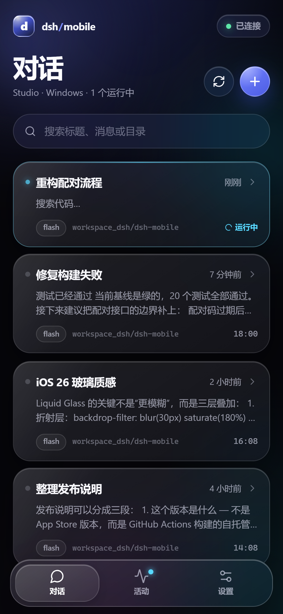
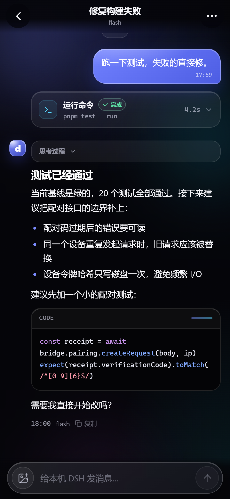
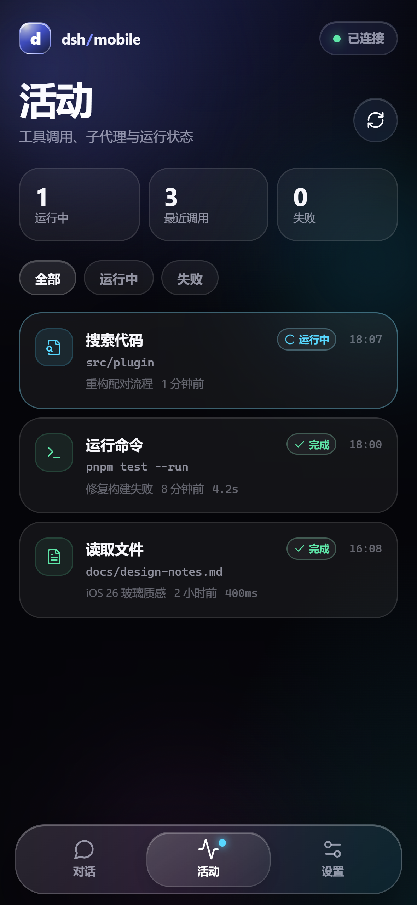
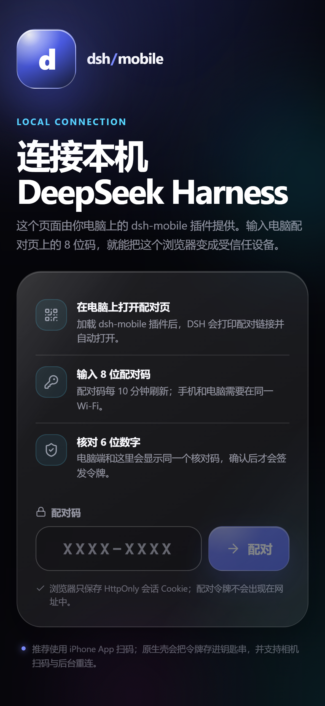

# dsh-mobile

> 一个 iOS 26 Liquid Glass 风格的自托管壳，把本机 **DeepSeek Harness** 放到手机上。
> 扫码绑定 · 局域网直连 · GitHub Actions 构建 · 自签安装，不经过 App Store。

  
  
  
  

---

## 这是什么

**dsh-mobile** 由三部分组成：

1. **DSH 插件**：安装在本机 DeepSeek Harness 里。它启动一个局域网桥接服务，生成配对二维码，并托管手机端 Web UI。
2. **手机端壳**：SwiftUI iOS App，负责扫码、钥匙串、系统级错误恢复、原生设置和 WKWebView 容器；对话界面由插件提供的移动 Web UI 渲染。
3. **GitHub Actions 流水线**：构建模拟器版本、未签名 IPA、可选的签名 IPA，并生成 AltStore 源和安装页。

手机只负责发消息。代码、文件、命令和会话都留在你的电脑上。桥接服务会启动一个**独立的 DSH SDK 运行时进程**（<code>dsh --profile sdk</code>），手机端通过稳定的 stdio JSON-RPC 协议驱动它。

不是 App Store 版本。iOS 不允许直接安装未签名 IPA；本项目提供 **AltStore / SideStore 源**、**未签名 IPA** 和 **自带证书签名** 三种路径。详见 [iOS 安装](docs/ios-install.md)。

---

## 功能

- **扫码配对**：二维码包含桥接地址、一次性配对码和服务器指纹；电脑端核对 6 位数字后才签发设备令牌。
- **iOS 26 Liquid Glass**：连续圆角、折射/高光/边缘三层玻璃、动态 Aurora 背景、浮动 Tab Bar、弹簧动效、深浅色。
- **对话**：会话列表、搜索、新建会话（可指定工作目录）、Markdown、代码块、图片附件、工具调用卡片、运行状态、停止。
- **活动**：跨会话查看工具调用、失败和运行中状态，点击跳回对应消息。
- **安全**：设备令牌只在钥匙串；服务端只存 SHA-256 哈希；可随时在电脑配对页吊销；管理页仅本机可访问。
- **断线可恢复**：WebSocket 自动重连、一次性 WS ticket、持久化事件日志、重连后补齐消息。
- **自托管发布**：未签名/已签名 IPA、AltStore 源、OTA manifest、安装页和校验和。

---

## 快速开始

### 1. 在电脑上安装 DSH 插件

**Windows**（仓库根目录）：

~~~powershell
powershell -ExecutionPolicy Bypass -File .\scripts\install-plugin.ps1 -Local
~~~

**macOS**：

~~~bash
chmod +x scripts/install-plugin.sh
./scripts/install-plugin.sh --local
~~~

从 GitHub 安装（替换 <code>YOUR_NAME</code>）：

~~~powershell
.\scripts\install-plugin.ps1 -Source github:YOUR_NAME/dsh-mobile
~~~

也可以直接在 DSH 的 **Settings → Plugins** 里安装 <code>github:YOUR_NAME/dsh-mobile</code> 并启用 bundle。

重启 DeepSeek Harness。配对页应该自动打开；如果没有，在日志里搜索：

~~~text
[dsh-mobile] pairing page: http://127.0.0.1:47821/pair?admin=...
~~~

> 电脑和手机必须在同一局域网。Windows 首次启动可能弹出防火墙提示，请允许 Node/DeepSeek Harness 访问专用网络。

### 2. 安装 iPhone App

推荐流程（不需要 Apple 开发者账号）：

1. 把仓库推到 GitHub，启用 Actions 和 Pages（Settings → Pages → Source: GitHub Actions）。
2. 运行 **iOS Build & Self-hosted Release**，或打一个 <code>v0.1.0</code> 标签。
3. 添加 AltStore 源：

   ~~~text
   https://YOUR_NAME.github.io/dsh-mobile/altstore.json
   ~~~

4. 在 AltStore / SideStore 里安装 **dsh-mobile**，它会用你的 Apple ID 重签。
5. 首次打开前：**设置 → 通用 → VPN 与设备管理 → 信任开发者证书**。

没有 AltStore？下载 Actions 里的 <code>dsh-mobile-unsigned.ipa</code>，用 SideStore、Sideloadly、Apple Configurator 或自己的证书自签。详见 [iOS 安装](docs/ios-install.md)。

### 3. 扫码绑定

1. 打开 dsh-mobile App。
2. 点「扫描配对二维码」，扫描电脑配对页上的二维码。
3. 手机显示 6 位核对码；电脑配对页显示同一个数字。
4. 在电脑上点「允许连接」。
5. 手机拿到设备令牌并写入钥匙串，进入对话列表。

之后只要插件重新加载、手机和电脑还在同一网络，App 会自动重连。

---

## 架构

~~~text
┌──────────────────────────── 你的电脑 ────────────────────────────┐
│  DeepSeek Harness                                               │
│  ├─ dsh-mobile 插件                                              │
│  │   ├─ PairingService   扫码 / 6 位核对 / 设备令牌 / 吊销       │
│  │   ├─ JournalStore     手机端会话、消息、工具卡片（JSON）      │
│  │   ├─ BridgeServer     HTTP + WebSocket :47821                 │
│  │   └─ SdkRuntime       spawn dsh --profile sdk                │
│  └─ 本机文件 / 命令 / 模型 / DSH 会话日志                         │
└──────────────────────────────┬──────────────────────────────────┘
                               │ LAN HTTP / WebSocket
                               │ Bearer token + one-time WS ticket
┌──────────────────────────────┴──────────────────────────────────┐
│  iPhone · dsh-mobile                                             │
│  ├─ SwiftUI 壳：扫码 / 钥匙串 / 错误恢复 / 原生设置              │
│  └─ WKWebView：Liquid Glass 移动 UI（由插件托管）                │
└──────────────────────────────────────────────────────────────────┘
~~~

- **DSH 插件**通过 Cordis bundle patch 加载，入口是根目录 <code>package.json</code> 的 <code>dsh.bundle.patch</code>。
- **手机 Web UI** 在 <code>src/web</code>，构建产物 <code>web-dist/</code> 由插件直接托管。
- **SDK 运行时**使用官方 stdio JSON-RPC，不依赖 DSH 内部私有 API。
- **事件日志**持久化在 <code>$DSH_HOME/dsh-mobile/sessions/</code>，重连/重启后可回放手机端消息和工具卡片。
- **原生壳**通过注入的 <code>window.__DSH_MOBILE__</code> 把令牌交给 Web UI。

更多：[架构](docs/architecture.md) · [配对协议](docs/pairing-protocol.md)

---

## 安全模型

| 风险 | 处理 |
| --- | --- |
| 谁可以配对 | 配对码 10 分钟轮换；电脑端人工允许；两侧核对 6 位数字 |
| 配对页被局域网访问 | 只接受 loopback（127.0.0.1/::1）+ 每次启动随机 admin token |
| 设备令牌泄露 | 只保存在 iOS 钥匙串 / HttpOnly SameSite=Strict Cookie；服务端只存 SHA-256 |
| 令牌长期有效 | 180 天；配对页可随时移除设备 |
| 重放 | 配对码一次性；请求 3 分钟过期；WebSocket 需要 30 秒一次性 ticket |
| 跨站请求 | Origin 校验、SameSite Cookie、限流 |
| 明文 HTTP | 默认局域网 HTTP（令牌保护）；公网请用 HTTPS 反代 / Tailscale 并设置 <code>publicUrl</code> |
| 权限过大 | 默认 <code>workspace-write</code>；<code>danger-full-access</code> 会显式警告；需要审批的操作 fail closed |

> 这是个人自托管工具，不是多租户服务。只在自己信任的网络和设备上配对。不要在没有 TLS 的公网暴露端口。

---

## 配置

默认配置在 <code>cordis.patch.yml</code>：

~~~yaml
- insert:
    - id: dsh-mobile
      name: dsh-mobile
      config:
        port: 47821
        bindHost: 0.0.0.0
        permissionMode: workspace-write
        provider: deepseek-official
        model: deepseek-flash
        openPairingPage: true
        printTerminalQr: true
~~~

| 字段 | 默认 | 说明 |
| --- | --- | --- |
| <code>port</code> | 47821 | 端口被占用时自动尝试后续 9 个端口，再退到随机端口 |
| <code>bindHost</code> | 0.0.0.0 | 手机访问需要非 loopback 地址 |
| <code>publicUrl</code> | 未设置 | HTTPS 反代 / Tailscale 根地址；二维码会使用它 |
| <code>workspace</code> | 进程 cwd | 默认工作目录 |
| <code>permissionMode</code> | workspace-write | 或 danger-full-access |
| <code>provider</code> / <code>model</code> | deepseek-official / deepseek-flash | SDK 模型路由 |
| <code>serverName</code> | 主机名 | 配对页和 App 显示名 |
| <code>openPairingPage</code> | true | 启动后自动打开本机配对页 |
| <code>printTerminalQr</code> | true | 在 DSH 日志打印终端二维码 |
| <code>autoApprove</code> | false | 仅开发/自动化；生产保持 false |
| <code>stateDir</code> | $DSH_HOME/dsh-mobile | 设备、会话日志和状态目录 |

环境变量：<code>DSH_MOBILE_PORT</code>、<code>DSH_MOBILE_BIND</code>、<code>DSH_MOBILE_PUBLIC_URL</code>、<code>DSH_MOBILE_WORKSPACE</code>、<code>DSH_MOBILE_PERMISSION_MODE</code>、<code>DSH_MOBILE_MODEL</code>、<code>DSH_MOBILE_SERVER_NAME</code>、<code>DSH_MOBILE_STATE_DIR</code>。

**关于审批**：SDK <code>dsh --profile sdk</code> 没有手机端审批回调。<code>workspace-write</code> 下需要审批的工具调用会 fail closed；如果希望手机端执行所有命令，请切换到 <code>danger-full-access</code>，并确认网络可信。

---

## 开发

要求：Node 22+、pnpm 11+、Chrome（仅截图需要）。

~~~bash
pnpm install
pnpm build          # lib/index.js + web-dist/
pnpm test           # 协议、日志、配对、桥接集成测试
pnpm typecheck
~~~

本地调试 Web UI + mock 运行时：

~~~bash
# 终端 1：桥接 + mock SDK，端口 47821
pnpm dev

# 终端 2：Vite 热更新，端口 5173
pnpm dev:web
~~~

打开 http://127.0.0.1:5173 。Vite 把 <code>/api</code> 和 <code>/ws</code> 代理到桥接服务；mock 模式不消耗真实模型额度。

生成 UI 截图：

~~~bash
pnpm screenshots
# 输出：Preview/screenshots/*.png
~~~

iOS：

~~~bash
brew install xcodegen
cd ios
xcodegen generate
open dsh-mobile.xcodeproj
~~~

模拟器运行不需要签名。真机需要你自己的证书/描述文件，或使用 AltStore 重签。

---

## 仓库结构

~~~text
.
├─ src/                DSH 插件、共享协议、Web UI、mock
├─ lib/                构建后的插件（提交到仓库，便于直接安装）
├─ web-dist/           构建后的移动 UI（提交到仓库）
├─ cordis.patch.yml    DSH bundle 入口
├─ ios/                SwiftUI 壳 + XcodeGen 工程描述 + 资源
├─ .github/workflows/  CI / iOS 构建 / 自托管发布
├─ scripts/            安装、截图、安装页生成
├─ docs/               架构、协议、安装、CI 文档
└─ Preview/            设计截图与图标
~~~

---

## 已知限制

- **不镜像桌面会话**：手机端运行独立的 SDK 运行时，不会出现在桌面 DSH 当前会话里；日志仍在同一个 <code>$DSH_HOME</code>。
- **没有逐 token 流式输出**：SDK 只转发已提交的 session event；界面显示运行状态和工具进度，最终文本在完成时出现。
- **停止会重启**：SDK 没有单轮取消；「停止」重启运行时并中断所有运行中的会话，UI 会先确认。
- **没有手机端审批**：见上文，默认失败关闭。
- **没有内置公网隧道**：请自己加 Tailscale / Cloudflare Tunnel / HTTPS 反代，并配置 <code>publicUrl</code>。
- **iOS 26 风格是自绘的**：不依赖 Xcode 26 的 <code>glassEffect</code>，可在 iOS 17+ / Xcode 16 构建。
- **未签名 IPA 不能直接安装**：必须自签或 AltStore/SideStore；GitHub Actions 无法凭空生成受信任签名。
- **只实现 iOS**：Android 和桌面端未实现。

---

## 文档

- [架构与数据流](docs/architecture.md)
- [配对协议与 API](docs/pairing-protocol.md)
- [在 DSH 中安装/升级插件](docs/plugin-install.md)
- [iOS 自签安装与信任](docs/ios-install.md)
- [GitHub Actions、签名 Secrets 与 Pages](docs/github-actions.md)
- [设计系统：iOS 26 Liquid Glass](docs/design.md)

## License

MIT © 2026 dsh-mobile contributors
